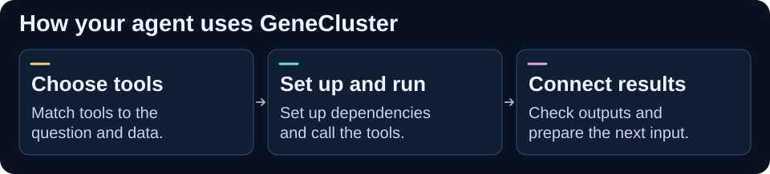

# BioSymphony GeneCluster

GeneCluster gives your agent the tool knowledge to plan and run comparative
genome and transcriptome analyses. Its guides cover which tools to use, how
to set them up, what inputs they need, and how to connect their outputs.

## Give Your Agent GeneCluster Superpowers

Share [this repo](https://github.com/BioSymphony/genecluster) with your agent
and ask it to read [GeneCluster Superpowers](skills/genecluster-superpowers/SKILL.md).
Give it your question, organisms, and available data.

> Read GeneCluster Superpowers. Compare candidate genes across [organisms]
> using [my reference proteins, target proteomes, and matching genome
> annotations]. Choose and set up the tools you need, then run the analysis.
> Return a candidate table with source accessions and compare gene order
> where coordinates are available.

<a href="docs/diagrams/genecluster-session-flow.svg">
  <picture>
    <source media="(max-width: 720px)" srcset="docs/diagrams/genecluster-session-flow-mobile.svg">
    
  </picture>
</a>

## What Your Agent Can Do

| Task | Tools | Output |
|---|---|---|
| Find related proteins | [MMseqs2](docs/tooling/mmseqs2.md), BLAST, DIAMOND | Protein IDs, alignments, scores |
| Annotate families and domains | [InterProScan, HMMER, and Pfam](docs/tooling/interproscan-pfam.md) | Signature IDs and residue ranges |
| Compare protein folds | [Foldseek + ProstT5](docs/tooling/foldseek-prostt5.md) | Structural matches |
| Look up plant pathways and enzymes | [PlantCyc and P450Rdb](docs/tooling/plantcyc-p450rdb.md) | Reference pathway and enzyme records |
| Predict candidate regions | [antiSMASH](docs/biosymphony-antismash-cookbook.md) for bacteria and fungi, [plantiSMASH](docs/tooling/plantismash.md) for plants | Annotated regions |
| Search and compare neighborhoods | [cblaster + clinker](docs/tooling/cblaster-clinker.md), [JCVI MCScan](docs/tooling/jcvi-mcscan.md) | Gene maps and synteny anchors |
| Build reports | [Quarto](docs/tooling/quarto.md), [Cytoscape.js](docs/tooling/cytoscape-js.md) | HTML reports and interactive networks |

## Set Up, Run, And Connect Tools

The [tool knowledge base](docs/tooling/README.md) gives your agent the input
formats, database requirements, commands, and expected outputs. The
[installers and templates](tools/recommended/README.md) and
[version table](docs/biosymphony-tooling-status.md) help it set up the tools
needed for the task. The [calling guide](docs/tooling/tool-chaining.md) shows
which wrappers to run and which commands to adapt.

<a href="docs/diagrams/genecluster-tool-chain.svg">
  <picture>
    <source media="(max-width: 720px)" srcset="docs/diagrams/genecluster-tool-chain-mobile.svg">
    
  </picture>
</a>

For neighborhood comparisons, your agent can pass cblaster's search session
to cluster extraction and open the resulting GenBank regions in clinker.

For longer analyses, your agent can use the
[campaign helpers](skills/biosymphony/SKILL.md) to track inputs and resume stages.
See the [tooling radar](docs/biosymphony-next-tooling-radar.md) for tools to
evaluate and [Contributing](CONTRIBUTING.md) for maintainer checks.
