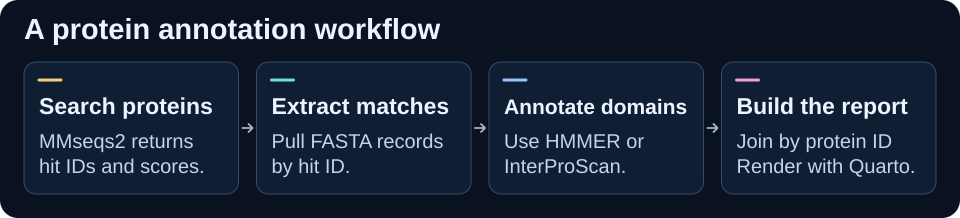

# BioSymphony GeneCluster

GeneCluster helps your agent find candidate biosynthetic genes, compare pathways
across species, and plan experiments. Your agent uses tool guides, setup scripts,
command wrappers, and workflow templates to connect sequence searches, domain
annotations, structure comparisons, expression data, and genomic neighborhoods.

## Start With Your Agent

Share the [GeneCluster repository](https://github.com/BioSymphony/genecluster) with your agent
and ask it to read [GeneCluster Superpowers](skills/genecluster-superpowers/SKILL.md).
Give it your question and organisms, plus any data, accessions, or compute limits.

> Read GeneCluster Superpowers and investigate the missing steps in [pathway]
> across [organisms]. Find suitable public datasets and reference enzymes,
> incorporate [my data, if any], and run the analysis within
> [compute and time budget]. Choose and set up the tools. Prepare each tool’s
> inputs from the previous results.
>
> Rank candidate genes using sequence, domain, and available genome-context
> evidence. Return a candidate table
> grouped by pathway step and species, neighborhood plots for annotated genomes,
> and a plan to test the leading candidates. Include source accessions, controls,
> and commands.

<a href="docs/diagrams/genecluster-session-flow.svg">
  <picture>
    <source media="(max-width: 720px)" srcset="docs/diagrams/genecluster-session-flow-mobile.svg">
    
  </picture>
</a>

## Tools Your Agent Can Use

| Task | Tools | What you get |
|---|---|---|
| Find public inputs | [NCBI Datasets, Ensembl, and nf-core/fetchngs](docs/biosymphony-next-tooling-radar.md#find-public-inputs) | Assembly accessions, annotation releases, and RNA-seq run accessions |
| Search for homologs | [MMseqs2](docs/tooling/mmseqs2.md), BLAST, DIAMOND | Protein or transcript matches, alignments, and scores |
| Annotate protein families and domains | [InterProScan and HMMER/Pfam](docs/tooling/interproscan-pfam.md) | Signature IDs and residue ranges |
| Compare protein folds | [Foldseek + ProstT5](docs/tooling/foldseek-prostt5.md) | Matches from structures or sequence-derived representations |
| Look up plant pathways and enzymes | [PlantCyc and P450Rdb](docs/tooling/plantcyc-p450rdb.md), [Rhea](docs/biosymphony-next-tooling-radar.md#find-public-inputs) | Pathway, enzyme, and reaction records |
| Predict candidate gene clusters | [antiSMASH](docs/biosymphony-antismash-cookbook.md) for bacteria and fungi, [plantiSMASH](docs/tooling/plantismash.md) for plants | Annotated genomic regions |
| Compare genomic neighborhoods | [cblaster + clinker](docs/tooling/cblaster-clinker.md) | Conserved neighborhoods and interactive gene maps |
| Compare gene order | [JCVI MCScan](docs/tooling/jcvi-mcscan.md) | Synteny anchors and plots |
| Present results | [Quarto](docs/tooling/quarto.md), [Cytoscape.js](docs/tooling/cytoscape-js.md) | HTML reports and interactive networks |

The [tooling radar](docs/biosymphony-next-tooling-radar.md) covers tools to
evaluate, including OrthoFinder for orthogroups, IsoQuant and SQANTI3 for long-read
transcriptomes, and [CLEAN and HIT-EC](docs/tooling/clean-hit-ec.md) for enzyme
classification.

## Example Requests For Your Agent

- “Investigate a missing enzyme in [plant pathway]. Use PlantCyc, P450Rdb, or
  Rhea to select references, search related species with MMseqs2, and annotate
  hits with HMMER or InterProScan. Rank candidates against characterized enzymes
  and related proteins with other functions.”
- “Compare this candidate cluster across [species]. Find homologs with cblaster,
  draw neighborhoods with clinker, and compare gene order with JCVI MCScan.
  Report conserved genes, tandem duplicates, and apparent losses, checking
  assembly and annotation gaps.”
- “Search these transcriptome assemblies for [pathway] enzymes. Combine
  translated BLAST searches and domain annotation, distinguish partial ORFs and
  isoforms, and compare available expression evidence across tissues. Return
  candidate transcripts and the sequences to use for follow-up.”
- “Investigate these divergent enzyme candidates. Use Foldseek to search a
  reference set with structures or ProstT5-derived representations. Compare
  those hits with sequence alignments and domain architecture. Show which
  candidates each analysis supports and where the results disagree.”
- “Plan the next experiments for this candidate list. Compare additional
  computational analysis, tissue RNA-seq, isoform checks, and enzyme assays.
  Specify the question, samples, controls, readouts, and decision criteria for
  each proposed experiment within [budget].”

## Chain Tools Into A Comparative Study

Your agent uses the [tool knowledge base](docs/tooling/README.md) to check file
formats and database requirements. It checks tested versions in the
[version table](docs/biosymphony-tooling-status.md), sets up tools with the
[installers and templates](tools/recommended/README.md), and follows the
[calling guide](docs/tooling/tool-chaining.md) for runnable wrappers and
templates to adapt.

<a href="docs/diagrams/genecluster-tool-chain.svg">
  <picture>
    <source media="(max-width: 720px)" srcset="docs/diagrams/genecluster-tool-chain-mobile.svg">
    
  </picture>
</a>

To extend a protein search to genome context, your agent maps hit protein IDs to
genes in the matching genome annotation and retains assembly accessions,
coordinates, and strand.
It can then connect two complementary analyses:

- cblaster searches annotated genomes with seed proteins, saves the search
  session, and extracts GenBank regions. clinker reads those regions to compare
  neighborhood composition and gene orientation.
- JCVI MCScan takes BED coordinates and CDS FASTA with matching feature IDs
  to produce synteny anchors and gene-order plots.

Your agent joins the results into a candidate table grouped by pathway step and
species, with separate columns for sequence scores, domain calls, genomic
context, and available expression evidence. That comparison identifies candidates
for follow-up and questions that need additional data.

For longer analyses, your agent can use the
[campaign helpers](skills/biosymphony/SKILL.md) to track inputs and resume stages.
The [experiment-planning guide](skills/biosymphony/references/campaigns/genecluster-next-experiment-design.md)
provides patterns for choosing sequencing, metabolomics, or enzyme-validation
experiments that resolve a specific evidence gap.
See [Contributing](CONTRIBUTING.md) for maintainer checks.
